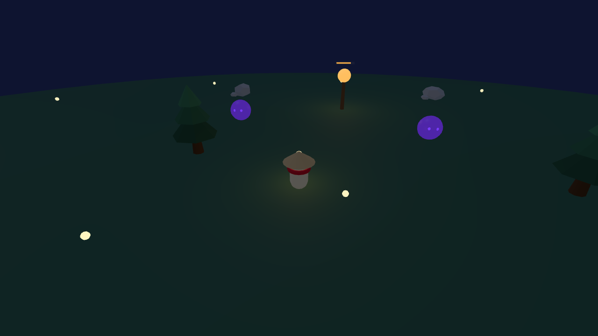
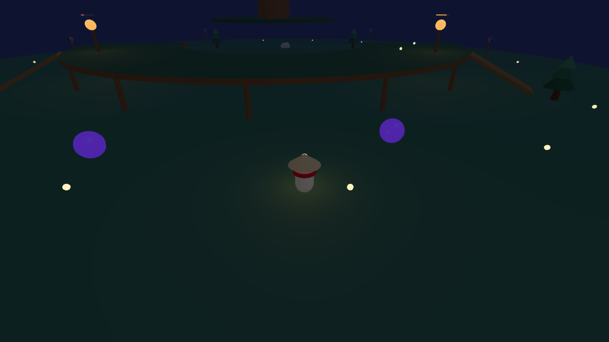

# Đảo Đèn Lồng — v1.0.0

> 🎬 **Video demo:** [demo.mp4 (đính kèm Release v1.0.0)](https://github.com/nvh-03/K5-L3A-DAY12-NguyenVanHuy-2A202603432-AI-SDLC-Dao-Den-Long/releases/download/v1.0.0/demo.mp4) · **Bản chạy được:** [Release v1.0.0](https://github.com/nvh-03/K5-L3A-DAY12-NguyenVanHuy-2A202603432-AI-SDLC-Dao-Den-Long/releases/tag/v1.0.0)

Game 3D trên trình duyệt. **Mây**, người giữ đèn nhỏ tuổi, gom **đom đóm** để thắp và **giữ dầu** cho các Đèn Lồng Lớn qua **3 Đêm** (Đảo Bến → Đảo Cau → Đảo Chuông). Trên đường đi phải né **Bóng Mực** (chúng hút dầu những đèn yếu) và **Gió Lạc** (chuyên cướp đom đóm). Còn sống tới **bình minh** với ít nhất 60% số đèn đang sáng thì thắng Đêm đó. Thắng cả ba Đêm là tới **Bình Minh**. Trên đảo có cây và đá chắn đường.

Một lõi mô phỏng **tất định** dùng chung cho bản chơi 3D (Three.js) và **chế độ headless** (Node) theo **Test Contract v1.3**. Kèm benchmark, soak test, bảng xếp hạng cục bộ và các tùy chọn trợ năng.

| Đêm 1 — Đảo Bến (cây, đá, thanh dầu trên đèn) | Đêm 3 — Đảo Chuông (sàn tầng 1, dốc, tháp) |
|---|---|
|  |  |

Cảnh benchmark chuẩn (200 Bóng Mực, 100 đom đóm): [docs/media/bench-scene.png](docs/media/bench-scene.png).

---

## Yêu cầu hệ thống

- **Node.js ≥ 18** (không có phụ thuộc npm; Three.js r160 đóng gói sẵn trong `vendor/`, **không cần mạng**).
- Trình duyệt có **WebGL2**: Chrome/Edge ≥ 100 hoặc Firefox ≥ 100. Đã thử: Chrome 157 trên Windows 11, GPU tích hợp Intel UHD.
- Benchmark cần **Chrome, Edge hoặc Chromium** (tự dò đường dẫn mặc định; nếu khác thì đặt biến `BENCH_BROWSER` tới file thực thi).
- Headless, test và soak chạy trên mọi hệ điều hành có Node, không cần GPU.

## Cài đặt và chạy (3 lệnh)

```bash
git clone https://github.com/nvh-03/K5-L3A-DAY12-NguyenVanHuy-2A202603432-AI-SDLC-Dao-Den-Long.git dao-den-long && cd dao-den-long
npm install          # không có dependency, chỉ kiểm tra môi trường
npm run web          # rồi mở http://localhost:8080
```

Từ bản phát hành: tải `dao-den-long-v1.0.0.zip` ở [Release v1.0.0](https://github.com/nvh-03/K5-L3A-DAY12-NguyenVanHuy-2A202603432-AI-SDLC-Dao-Den-Long/releases/tag/v1.0.0), giải nén, rồi chạy `node bin/serve.js` và mở http://localhost:8080.

> Bảng xếp hạng lưu ở `data/leaderboard.json` qua server cục bộ, nên hãy mở game bằng `npm run web` chứ không mở thẳng file `index.html`.

## Điều khiển (mặc định, đổi được trong **Cài đặt**)

| Phím | Hành động |
|---|---|
| `W A S D` | Di chuyển (theo hướng camera) |
| `◀ ▶` | Xoay camera |
| `Space` | Nhảy |
| `Shift` | Lướt — 14 m/s trong 0.2 s, hồi chiêu 1.5 s |
| `E` | Nạp đom đóm vào đèn tắt / châm dầu cho đèn đang sáng |
| `Q` | Tỏa sáng — choáng và đẩy Bóng Mực, tốn 3 đom đóm |
| `Esc` | Tạm dừng |

Nút **Ⅱ Menu** khi đang chơi mở menu tạm dừng (Cài đặt, Bảng xếp hạng, Menu chính).

## Luật chơi

- **Sức chứa** = 10 + 2 × số lần thắp thành công trong Đêm, tối đa **20**. Đom đóm **tự nhặt** khi đi ngang qua.
- Đèn chưa từng sáng cần **10** đom đóm, đèn đã từng sáng chỉ cần **5** để thắp lại (nạp nhiều lần, đèn nhớ tiến độ).
- **Dầu:** đèn vừa thắp có 100, hao 1/giây. Châm dầu: mỗi đom đóm +10. Hết dầu thì đèn tắt. Dầu < 30 thì đèn và thanh dầu nhấp nháy 1 Hz, đèn **mất vùng an toàn 6 m**, và Bóng Mực tới hút 5 dầu/giây.
- **Bóng Mực** đuổi khi Mây cách ≤ 12 m; bị chạm mất 1 Ngọn Lửa và rơi nửa số đom đóm. **Gió Lạc** (Đêm 2–3) cướp tối đa 3 đom đóm. **Rơi khỏi đảo** mất 1 lửa và toàn bộ đom đóm. **Đêm 3** có gió mạnh mỗi 30 s, đảo nhiều tầng, dốc và bục nhảy.
- **Cây và đá** không đi xuyên qua được (Mây trượt dọc theo mép); chúng chỉ có ở bản chơi và tắt trong headless/bench/soak.
- Mỗi Đêm dài **240 / 270 / 300 s**. **Thắng** khi còn sống lúc bình minh với số đèn sáng ≥ 3/5, 4/6, 5/7. **Thua** khi hết lửa hoặc thiếu đèn lúc bình minh.
- **Điểm:** +5 mỗi đom đóm nạp vào đèn, +100 thắp lần đầu, +40 thắp lại, +5 trúng Tỏa Sáng (+15 nếu Bóng đang hút dầu). Khi thắng, mỗi đèn sáng +50 + floor(dầu) và mỗi lửa còn lại +50. Tổng điểm = tổng các Đêm đã thắng.

## Bảng xếp hạng cục bộ

Sau màn Bình Minh hoặc khi thua ở bất kỳ Đêm nào, game cho nhập tên để lưu điểm. Tên dài 3–12 ký tự gồm `A–Z a–z 0–9 _`, **chấp nhận cả tiếng Việt có dấu** (vd. `Mây_Đêm_Ba`). Mỗi mục lưu `name, score, nights_won, achieved_at` (ISO 8601 có múi giờ) và `seed`. Bảng giữ top 10, xếp theo điểm giảm dần; bằng điểm thì ai đạt trước đứng trên. Dữ liệu lưu ở `data/leaderboard.json`, còn nguyên sau khi tắt và mở lại game. Xem từ nút **Bảng xếp hạng** ở menu chính.

```bash
node bin/serve.js --export-leaderboard out.json      # -> {"entries": [...]} đúng thứ tự
```

## Trợ năng (Cài đặt, được lưu)

- **Đổi phím** cho mọi hành động: 4 hướng, nhảy, lướt, tương tác, tỏa sáng, tạm dừng, xoay camera. Phát hiện trùng phím và báo tên hành động đang dùng phím đó. Có nút **Khôi phục mặc định**.
- **Phụ đề / chỉ báo hình ảnh:** Bóng Mực xuất hiện (kèm **mũi tên ở mép màn hình** chỉ hướng), gió sắp thổi, 10 s cuối, đèn có dầu < 30.
- **Giảm chuyển động:** tắt rung camera và chớp đỏ màn hình khi bị đánh.
- **Cỡ chữ:** tối thiểu 18 px ở 1280×720; tùy chọn **chữ lớn ×1.25**.
- **Bảng màu dễ phân biệt:** viền và mắt Bóng Mực #00B3FF, cảnh báo màu trắng kèm ⚠. Đèn tắt xẹp 20% và có vết rách giấy, nên phân biệt được tắt/sáng mà không cần màu.

---

## Chạy test

```bash
npm test     # 4 cổng: cơ chế (77) + Contract v1.3 (50 lần chạy) + fuzz/bất biến/tất định (60) + nền tảng Phase 4 (50)
```

`npm run test:unit` · `test:contract` · `test:invariants` · `test:platform` để chạy riêng từng cổng.

## Chế độ headless (Test Contract v1.3)

```bash
node bin/headless.js --seed <int> --night <1|2|3> [--scenario f.json] [--inputs f.json] \
     --ticks <int> --out <file.jsonl> [--snapshot-every <int, mặc định 10>]
```

- Logic cố định **60 tick/giây**, tất định, không cần cửa sổ hay GPU. Một Đêm đầy đủ chạy dưới 1 giây.
- Thoát mã **0** nếu thành công; mã khác 0 kèm stderr nếu lỗi; **mã 2** nếu file inputs/scenario sai định dạng.
- **snapshot** (tick 0 và mỗi `--snapshot-every`): `type,tick,sim_tick,state,night,time_left_s,score,wind{active,dir_deg}, player{pos,vel,grounded,flames,carried,capacity,invuln,dash_cd_s,pulse_cd_s,charm_s}, lanterns[{id,pos,lit,deposited,fuel,ever_lit,relit_count}], shades[{id,pos,state}], motes[{id,pos,kind,ttl_s}], drifters[…], charms[…]`. `fuel` có 1 chữ số thập phân, toạ độ 3 chữ số.
- **event**: `night_start, mote_picked, deposit, lantern_lit{relight}, refuel, lantern_out, fuel_drain, pulse, player_hit, dash, charm_picked, drifter_steal, drifter_drop, paused, resumed, game_over{reason ∈ dawn_survived|dawn|no_flames}`.
- Trạng thái Bóng Mực: `spawning, wander, chase, recoil, stunned, drain`. Khi tạm dừng, `tick` tăng nhưng `sim_tick` đứng yên.
- Ví dụ: `node bin/headless.js --seed 1 --night 1 --scenario tests/scenarios/p3-dawn-win.scenario.json --ticks 120 --out out.jsonl --snapshot-every 60`

## Benchmark

```bash
node bin/bench.js --seed 42 --duration 30 --out bench.json      # hoặc: npm run bench
```

Lệnh mở một cửa sổ Chrome/Edge 1280×720 (không toàn màn hình), canvas render đúng 1280×720. Cảnh chuẩn gồm Đêm 1 với đầy đủ hiệu ứng, **200 Bóng Mực wander** rải đều theo seed, **100 đom đóm**, đèn L1–L3 sáng với dầu 100, Mây đứng yên ở (0,0,0), camera bay vòng R = 30 m, Y = 15 m, ngược chiều kim đồng hồ, 15 s/vòng. Cảnh tắt sinh thêm, sát thương, nhặt, hao dầu và kết thúc Đêm, nhưng giữ luật wander của lõi. Không có cây/đá (phần sáng tạo tắt). Bench khởi động 3 s, đo 30 s, ghi `bench.json` rồi thoát mã 0.

- **vsync:** trang web không tự tắt được vsync, nên bench chạy Chromium với `--disable-gpu-vsync --disable-frame-rate-limit` (`vsync_off: true`).
- **peak_mem_mb: null:** bản web chạy trong tiến trình trình duyệt nhiều process (GPU, renderer…) và trang không đọc được RSS của chúng; JS heap không phải RSS nên không ghi thay.
- Kết quả trên máy dev (Windows 11, Intel UHD Graphics, Chrome 157): **avg 138 FPS · p1-low 63 FPS · p95 9.7 ms · load 2.2 s**. Xem [bench.json](bench.json).

## Soak test

```bash
node --expose-gc --max-semi-space-size=1 bin/soak.js --seed 7 --nights 10 --out soak.json      # hoặc: npm run soak
```

Chạy headless 10 Đêm liên tiếp trong cùng một tiến trình (Đêm 1 → 2 → 3 xoay vòng, Đêm thứ i đếm từ 0 dùng seed 7 + i) với input ngẫu nhiên theo seed: đổi hướng mỗi 30 tick; mỗi tick 5% nhảy, 3% lướt, 2% tỏa sáng, 10% tương tác. `--expose-gc` cho phép dọn rác trước khi đo RSS. `--max-semi-space-size=1` giới hạn vùng nhớ trẻ của V8 để RSS không phình vì heap dự trữ. Đã kiểm `heapUsed` sau GC phẳng ~5.3 MB từ Đêm 10 tới Đêm 400, tức không rò rỉ. Kết quả: [soak.json](soak.json).

---

## Cấu trúc thư mục

```
game.contract.json     Test Contract v1.3 (tuning, score, run/headless/bench/soak_cmd)
index.html             Bản chơi web; benchmark.html / preview.html: cảnh đo và cảnh chụp ảnh
src/core/              Lõi tất định: rng, config (số chuẩn + bản đồ + cây/đá), geometry, sim, headlessRun, benchmark
src/render/            Three.js: view (cảnh), main (game + UI), benchmark, preview, style.css
src/platform/          leaderboard, settings (đổi phím), bench-metrics
bin/                   serve (web + API bảng xếp hạng + export), headless, bench, soak
tests/                 4 cổng test + scenarios/ cho mỗi tính năng
vendor/                three.module.js r160 (MIT)
docs/                  spec/, proof/ (bằng chứng từng phase), notes/ (giả định, ADR, nhật ký AI, retro), media/
bench.json soak.json   Kết quả đo tự chạy (Ticket-04)
```

## Tài liệu

[CHANGELOG](CHANGELOG.md) · [CREDITS](CREDITS.md) · [LICENSE](LICENSE) · [AGENTS.md](AGENTS.md) (harness AI) · [Giả định](docs/notes/assumptions.md) · [ADR-001](docs/notes/adr-001-den-can-dau.md) · [Retro](docs/notes/retro.md) · [Nhật ký AI](docs/notes/ai-log.md) · Bằng chứng: [Phase 2](docs/proof/phase-2.md) · [Phase 3](docs/proof/phase-3.md) · [Phase 4](docs/proof/phase-4.md)

Tài liệu lab: [GUIDE](GUIDE.md) · [CHECKPOINTS](CHECKPOINTS.md) · [SUBMISSION](SUBMISSION.md) · [RULES](RULES.md) · [RUBRIC](RUBRIC.md)
